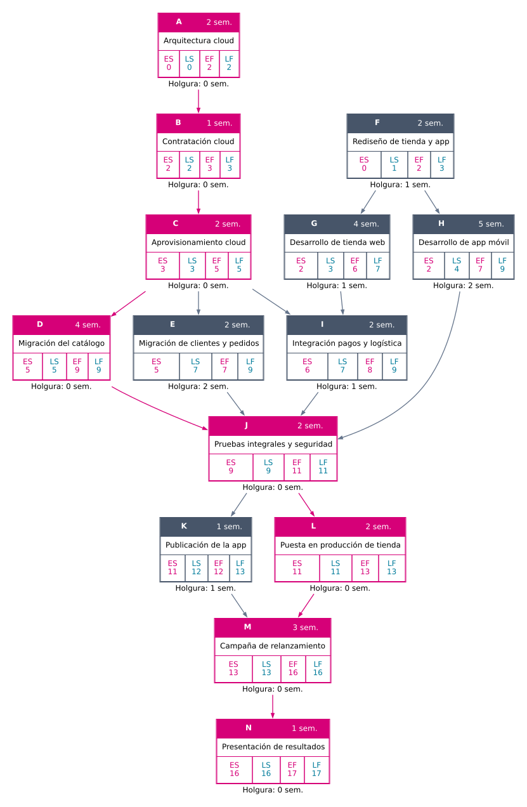
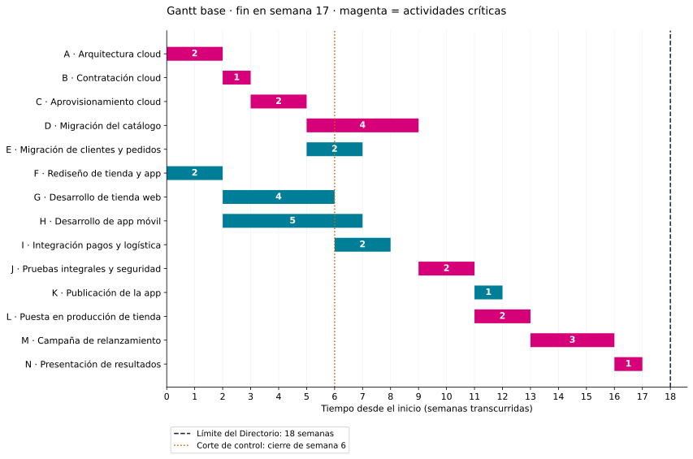
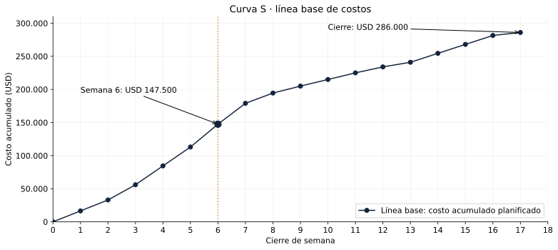
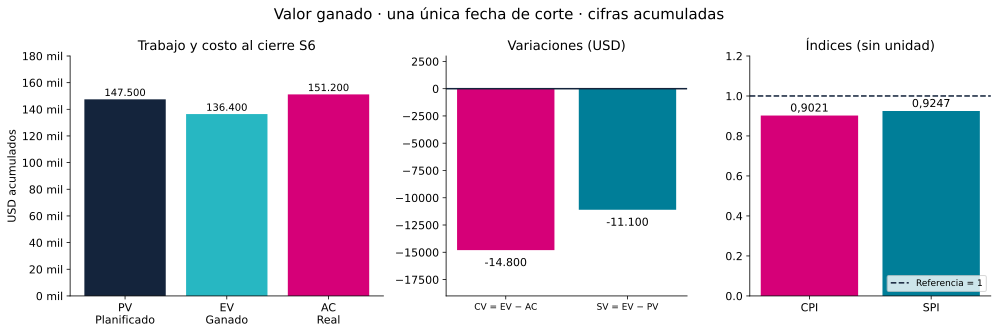

# Hogar Norte: teoría y práctica, tema por tema

Material de estudio de las ocho consignas. Tiempo en **semanas** y dinero en **dólares estadounidenses (USD)**. Se conserva el [PDF original](Ejercicio_DPI_Migracion_Ecommerce_Hogar_Norte.pdf) y la [consigna extraída](exercise_prompt.md).

En cada apartado vas a encontrar **una explicación corta y, enseguida, su aplicación al ejercicio**. Leé y resolvé un tema antes de pasar al siguiente. Las fórmulas aparecen junto a las cuentas en las que se usan.

Para aprender valor ganado vamos a usar un catálogo pequeño de 100 productos. Siempre estará dentro de la parte de teoría. Las aplicaciones identificadas como **Hogar Norte** usan los datos reales de la consigna.

Hogar Norte quiere renovar su tienda por Internet, publicar una **app (aplicación móvil)** y mover la tienda a la **nube**, llamada *cloud* en el enunciado: usar servidores de un proveedor en lugar de los propios. Tenemos que averiguar cuánto tarda, cuánto cuesta y cómo viene avanzando.

Las referencias [T1] a [T4] señalan las clases originales, enlazadas al final. Los supuestos se explican en el tema al que corresponden.

## 1. Actividades y costos · consigna 1

Primero separamos qué hay que hacer. Después calculamos cuánto cuesta cada trabajo, usando la información que tengamos para estimarlo.

### 1.1. Separar el trabajo

#### Teoría

Imaginá que te dicen: “Hacé la migración”. Con esa frase todavía no podés organizar nada. Necesitás separar qué hay que hacer.

En el caso, por ejemplo, hay que:

- Diseñar la nueva infraestructura.
- Contratar al proveedor.
- Preparar los servidores y las redes.
- Pasar los productos a la nueva tienda.

Cada trabajo de esa lista es una **actividad**. Le vamos a poner una letra para reconocerla en las tablas y los dibujos. “A” será arquitectura; “B”, contratación, y así sucesivamente.

Ahora fijate en la contratación: no podemos preparar la infraestructura antes de tener el contrato firmado. Una tarea tiene que esperar a otra.

La que debe ocurrir primero se llama **predecesora**. En una tabla, escribir “predecesora: B” para la tarea C significa: **C tiene que esperar a que termine B**.

Una firma también puede marcar un momento importante, aunque firmar no tenga una duración separada en el cronograma. Ese punto de control se llama **hito**. En este ejercicio incluimos las firmas dentro de las tareas correspondientes; no les agregamos semanas inventadas.

*Fuente: clase de plazos, páginas 7–9 [T1].*

#### Aplicación en Hogar Norte

En Hogar Norte podemos reconocer esta primera secuencia:

- **A · Arquitectura cloud:** decidir cómo será la infraestructura. Dura dos semanas.
- **B · Contratación:** cerrar el acuerdo con el proveedor. Dura una semana y espera a A.
- **C · Aprovisionamiento:** dejar listos servidores, redes y entornos. Dura dos semanas y espera a B.

Por eso la ficha de B dirá “predecesora: A”, y la de C dirá “predecesora: B”. Las firmas se incluyen en sus actividades; no agregamos otra semana para firmar.

La lista completa aparece al final de este tema, una vez calculados sus costos.

### 1.2. Distinguir horas de trabajo y semanas de duración

#### Teoría

La consigna dice que desarrollar la web lleva **640 horas de trabajo** y se termina en **cuatro semanas**.

Están midiendo cosas distintas:

- **640 horas de esfuerzo:** cuánto trabajo humano hay que aportar en total.
- **Cuatro semanas de duración:** cuánto tiempo pasa desde que empieza hasta que termina la tarea.

Para verlo, pensemos en dos personas que trabajan ocho horas cada una durante un día. Entre ambas aportan **16 horas de trabajo**, aunque transcurrió **un solo día**.

En la web de Hogar Norte, 640 horas repartidas en cuatro semanas equivalen a **160 horas de trabajo por semana**. Podrían cubrirse, por ejemplo, con cuatro personas de 40 horas semanales. La consigna no confirma esa dotación; el ejemplo solo muestra por qué esfuerzo y duración no son iguales.

Esta diferencia importa por una razón práctica: **para armar el calendario usamos semanas; para pagar a un equipo con tarifa por hora usamos horas**.

*Base del ejemplo: horas y semanas informadas en la consigna, página 2 [E].*

#### Aplicación en Hogar Norte

Para la web usaremos **cuatro semanas** cuando armemos el cronograma. Para calcular el costo usaremos **640 horas** y la tarifa de **USD 50 por hora**.

Web y app se desarrollan al mismo tiempo porque así lo establece el caso. No contamos con una dotación detallada para comprobar si hay personas sobreasignadas; respetamos ese paralelismo informado.

### 1.3. Estimar por comparación

#### Teoría

Si tenemos el costo de un trabajo anterior parecido, podemos usarlo como referencia. Eso se llama **estimación análoga**.

La pregunta que la reconoce es: **“¿Cuánto nos costó algo similar?”** Conviene comprobar que los trabajos sean comparables en alcance; de lo contrario, habría que ajustar la referencia.

*Fuente: clase de costos, página 10 [T2].*

#### Aplicación en Hogar Norte

**F · Rediseño de tienda y app:** la referencia es el trabajo similar que la misma agencia hizo para Uruguay por **USD 15.000**.

Tomamos ese importe como estimación análoga. El enunciado no da ajustes por inflación ni diferencias de alcance; no los inventamos.

### 1.4. Estimar con cantidades y tarifas

#### Teoría

Para migrar el catálogo sabemos que se cobra **USD 0,50 por producto**.

Probemos primero con un catálogo pequeño de 100 productos:

**100 productos × USD 0,50 por producto = USD 50.**

Si fueran 200 productos con la misma tarifa, costaría USD 100. El costo crece con la cantidad.

Eso es una **estimación paramétrica**: calcular a partir de una cantidad y una tarifa por unidad. La unidad puede ser un producto, una hora o una semana.

En el ejercicio la aplicamos a los productos migrados y a las horas de desarrollo.

*Fuente: clase de costos, página 10 [T2].*

#### Aplicación en Hogar Norte

- **D · Catálogo:** 60.000 productos / 15.000 productos por semana = **4 semanas**. Costo: 60.000 × USD 0,50 = **USD 30.000**. Por semana: 15.000 × 0,50 = USD 7.500.
- **G · Web:** 640 horas × USD 50/hora = **USD 32.000**. Se respeta la duración informada de cuatro semanas; 640 no es una duración de calendario.
- **H · App:** 800 horas × USD 50/hora = **USD 40.000**, en las cinco semanas informadas.

### 1.5. Estimar cuando hay tres escenarios

#### Teoría

En la nube no sabemos con certeza cuánto costará preparar la infraestructura. Puede salir más barato si hay descuentos o más caro si las pruebas necesitan mucha capacidad.

Por eso el proveedor da tres importes:

- **Optimista:** lo que costaría si se da el escenario favorable.
- **Más probable:** lo que espera que ocurra normalmente.
- **Pesimista:** lo que costaría en el escenario desfavorable considerado.

Queremos reunirlos en una sola estimación, dándole más importancia al escenario más probable.

Para eso usamos **PERT**, sigla de *Program Evaluation and Review Technique*, técnica de evaluación y revisión de programas. Aquí la aplicamos al costo:

**Costo estimado = (optimista + 4 × más probable + pesimista) / 6.**

¿Por qué dividimos por seis? Porque estamos sumando seis “partes”: una del optimista, cuatro del más probable y una del pesimista. Es la ponderación que establece este método.

Ejemplo pequeño: optimista 100, más probable 130 y pesimista 180, todos en USD.

1. Damos peso cuatro al más probable: 4 × 130 = **520**.
2. Sumamos los tres aportes: 100 + 520 + 180 = **800**.
3. Dividimos por las seis partes: 800 / 6 = **USD 133,33**.

El resultado queda cerca de 130, pero algo por encima: el escenario caro tira el promedio hacia arriba. No significa que vayamos a pagar exactamente 133,33; es una estimación para planificar.

Cuando aparezcan las letras **O**, **m** y **P**, solo estarán abreviando optimista, más probable y pesimista. No cambian la cuenta.

*Fuente: clase de costos, páginas 8 y 11 [T2].*

#### Aplicación en Hogar Norte

**C · Aprovisionamiento cloud.** Optimista USD 14.000, más probable USD 18.000 y pesimista USD 28.000:

**(14.000 + 4 × 18.000 + 28.000) / 6 = 114.000 / 6 = USD 19.000.**

**E · Migración de clientes y pedidos.** Optimista USD 10.000, más probable USD 15.000 y pesimista USD 26.000:

**(10.000 + 4 × 15.000 + 26.000) / 6 = 96.000 / 6 = USD 16.000.**

En ambos casos el escenario pesimista está más alejado del más probable que el optimista; por eso el resultado esperado queda por encima del más probable. Estos escenarios son de **costo**, no de duración: C sigue durando dos semanas y E también.

Aquí usamos el resultado PERT en el presupuesto, porque la consigna lo pide. El ejemplo de la clase 5, página 11, mantiene el valor más probable en su propio caso; no trasladamos esa decisión a este ejercicio.

### 1.6. Resultado: lista completa de actividades

Por último, algunas tareas ya vienen con un importe único, como “arquitectura: USD 12.000”. Lo tomamos como **costo puntual dado**. La consigna no explica cómo lo estimaron, así que no le atribuimos un método que no conocemos.

Usamos letras A–N como identificadores. La **actividad M** es la campaña; la **m minúscula** de PERT significa “más probable”.

| ID | Actividad | Duración (sem.) | Predecesoras | Costo (USD) | Estimación |
| --- | --- | --- | --- | --- | --- |
| A | Arquitectura cloud | 2 | — | 12.000 | Puntual dada; origen no especificado |
| B | Contratación cloud | 1 | A | 4.000 | Puntual dada; origen no especificado |
| C | Aprovisionamiento cloud | 2 | B | 19.000 | Multipunto PERT |
| D | Migración del catálogo | 4 | C | 30.000 | Paramétrica: productos × tarifa |
| E | Migración de clientes y pedidos | 2 | C | 16.000 | Multipunto PERT |
| F | Rediseño de tienda y app | 2 | — | 15.000 | Análoga: filial Uruguay |
| G | Desarrollo de tienda web | 4 | F | 32.000 | Paramétrica: horas × tarifa |
| H | Desarrollo de app móvil | 5 | F | 40.000 | Paramétrica: horas × tarifa |
| I | Integración pagos y logística | 2 | G, C | 10.000 | Puntual dada; origen no especificado |
| J | Pruebas integrales y seguridad | 2 | D, E, H, I | 14.000 | Puntual dada; origen no especificado |
| K | Publicación de la app | 1 | J | 2.000 | Puntual dada; origen no especificado |
| L | Puesta en producción de tienda | 2 | J | 8.000 | Puntual dada; origen no especificado |
| M | Campaña de relanzamiento | 3 | K, L | 36.000 | Presupuesto dado; origen no especificado |
| N | Presentación de resultados | 1 | M | 3.000 | Puntual dada; origen no especificado |

La suma de los 14 costos directos es **USD 241.000**. La estructura se calculará después de conocer cuándo empieza la campaña y cuándo termina el proyecto. No se modela como una tarea adicional que condicione la red: es un gasto que acompaña las actividades.

## 2. Dependencias, red y camino crítico · consignas 2 y 3

Con las duraciones y las esperas definidas, ahora podemos averiguar cuándo termina todo. Vamos a calcular los tiempos en dos recorridos: primero hacia adelante y después hacia atrás.

### 2.1. Reconocer qué tarea espera a cuál

#### Teoría

Supongamos que dos trabajos empiezan juntos: uno tarda dos semanas y otro, tres.

Como ocurren al mismo tiempo, ambos estarán terminados al final de la semana **3**. No de la 5.

En Hogar Norte pasa eso: mientras se trabaja en infraestructura, también puede avanzar el rediseño. Más adelante, web y app se desarrollan en paralelo.

Para saber cuánto dura todo, necesitamos ver **qué puede hacerse al mismo tiempo y qué tiene que esperar**. Lo dibujamos con cajas y flechas:

**Contrato firmado → Preparar la infraestructura → Migrar el catálogo.**

Cada caja representa una actividad. La flecha se lee “primero debe terminar esta; después puede empezar la otra”. Este dibujo es una **red de actividades**.

La cátedra la llama **AON**, *Activity on Node*, actividad en el nodo: el trabajo está en la caja, también llamada nodo. La relación de espera se llama **FS**, *Finish to Start*, fin a inicio.

En el dibujo completo habrá ramas que se separan y vuelven a unirse. Cuando se unen, la siguiente tarea debe esperar a **todas** las que necesita.

Por ejemplo, las pruebas no pueden empezar solo porque terminó la app: también necesitan los datos migrados y la integración terminada.

*Fuente: clase de plazos, páginas 16 y 18 [T1].*

#### Aplicación en Hogar Norte

Estas son las dos esperas que suelen generar errores en este caso:

- **Integración I:** espera a la web G y al aprovisionamiento C. No alcanza con tener solo una de las dos listas.
- **Pruebas J:** espera al catálogo D, clientes E, app H e integración I. Las cuatro tienen que estar terminadas.

El rediseño F empieza desde el primer día. Los desarrollos G y H esperan a F; no les agregamos una espera al aprovisionamiento que el caso no establece.

### 2.2. Calcular los inicios y fines tempranos

#### Teoría

Primero calculemos lo más pronto que podría hacerse cada trabajo.

Usamos el instante **0** como inicio del proyecto. Si la arquitectura dura dos semanas, empieza en 0 y termina en 2. Eso significa que ocupa las semanas 1 y 2.

La contratación espera a la arquitectura. Por eso puede comenzar en 2. Como dura una semana, termina en 3.

Para escribir esto de manera breve se usan dos siglas:

- **ES — Early Start, inicio temprano:** lo más pronto que puede empezar.
- **EF — Early Finish, fin temprano:** cuándo termina si comienza en ese momento.

La cuenta es sencilla: **fin temprano = inicio temprano + duración**. En la contratación: 2 + 1 = 3.

#### Cuando una tarea espera a varias, manda la que termina última

Imaginá que para comenzar las pruebas necesitás dos trabajos: uno termina en 7 y el otro en 9.

No podés probar en 7 porque todavía te falta el segundo. Tenés que esperar hasta **9**.

Esta es la razón de la regla **“tomar el máximo de los fines de las predecesoras”**. “Máximo” simplemente significa elegir el más tardío de esos valores.

Ir calculando así, desde el comienzo hacia el final del proyecto, se llama **paso adelante**.

*Fuente: clase de plazos, página 27 [T1].*

#### Aplicación en Hogar Norte

**Infraestructura y datos:** A ocupa 0–2; B, 2–3; C, 3–5. Después se abren D, de 5 a 9, y E, de 5 a 7.

**Diseño y desarrollo:** F ocupa 0–2. Desde allí G ocupa 2–6 y H ocupa 2–7. La integración I espera a G y a C: ES de I = máximo(6, 5) = **6**; EF de I = 6 + 2 = **8**.

**Convergencia de pruebas:** J requiere D, E, H e I. Por lo tanto, ES de J = máximo(9, 7, 7, 8) = **9**. Aunque la app y los clientes estén listos en 7, las pruebas tienen que esperar al catálogo hasta 9. J termina en **11**.

**Salida y cierre:** K ocupa 11–12 y L ocupa 11–13. M espera a ambas: ES de M = máximo(12, 13) = **13**; termina en **16**. N ocupa 16–17. La presentación no es un hito de duración cero: el caso le asigna una semana.

**Acuerdo de calendario:** como no hay fecha inicial ni feriados, contamos semanas desde el instante 0. La presentación final dura una semana completa; las firmas se consideran incluidas en las actividades correspondientes.

### 2.3. Calcular el margen de cada tarea

#### Teoría

Ahora pensemos al revés: cuánto se puede posponer sin mover el cierre

Supongamos que una tarea de dos semanas tiene que estar lista como máximo en el instante 9.

Entonces puede empezar, como muy tarde, en **7**, porque 7 + 2 = 9.

Para esos límites se usan otras dos siglas:

- **LF — Late Finish, fin tardío:** lo más tarde que puede terminar sin atrasar el cierre calculado.
- **LS — Late Start, inicio tardío:** lo más tarde que puede empezar sin atrasarlo.

La cuenta ahora es **inicio tardío = fin tardío − duración**: 9 − 2 = 7.

Se calcula desde el final del proyecto hacia el principio. Por eso se llama **paso atrás**.

Si una actividad alimenta a dos tareas que necesitan empezar, como máximo, en 7 y en 9, debe estar lista en **7**. De lo contrario bloquearía a la primera. Esa es la razón de tomar el **mínimo** cuando hacemos el recorrido hacia atrás.

**La diferencia entre “podés empezar” y “tenés que empezar”**

Si una tarea puede empezar en 5, pero podría esperar hasta 7 sin cambiar el fin del proyecto, tiene **dos semanas de margen**.

Ese margen se llama **holgura**:

**Holgura = inicio tardío − inicio temprano = 7 − 5 = 2 semanas.**

Con las siglas: **LS − ES**. También se obtiene con los fines: **LF − EF**.

Una tarea con holgura cero no tiene ese margen. Si se retrasa y nadie recupera el tiempo, desplaza el cierre del proyecto.

La cadena que determina la duración total se llama **camino crítico**. El método para encontrarla se conoce como **CPM**, *Critical Path Method*, método del camino crítico. Buscamos el camino de mayor duración; “crítico” se refiere aquí a su efecto sobre la fecha, no al precio ni a la dificultad de la tarea.

Al mirar un nodo del dibujo, los cuatro casilleros se leen siempre en este orden: **ES | LS | EF | LF**. Todos sus números son semanas contadas desde el inicio, no costos ni cantidades de personas.

*Fuente: clase de plazos, páginas 19, 21 y 26–28 [T1].*

#### Aplicación en Hogar Norte

Anclamos el cierre calculado en **17**, no en 18: queremos la holgura respecto del plan de duración mínima. N tiene LF = 17 y LS = 16; M tiene LF = 16 y LS = 13. K y L deben terminar a más tardar en 13: K tiene LS = 12 y L tiene LS = 11.

J alimenta a K y L, por lo que LF de J = mínimo(12, 11) = **11** y LS de J = **9**. Sus cuatro predecesoras tienen que terminar como máximo en 9: D tiene LS = 5; E, LS = 7; H, LS = 4; I, LS = 7.

C alimenta a D, E e I: LF de C = mínimo(5, 7, 7) = **5**, y LS de C = **3**. G tiene LF = 7 y LS = 3. F alimenta a G y H: LF de F = mínimo(3, 4) = **3** y LS de F = **1**. Completamos B y A hasta volver al inicio.

### 2.4. Resultado: tiempos, red y cumplimiento del plazo

Todos los valores de esta tabla están en semanas transcurridas desde el inicio. La holgura usa el fin calculado de 17 semanas.

| ID | ES | LS | EF | LF | Holgura (sem.) | Crítica |
| --- | --- | --- | --- | --- | --- | --- |
| A | 0 | 0 | 2 | 2 | 0 | Sí |
| B | 2 | 2 | 3 | 3 | 0 | Sí |
| C | 3 | 3 | 5 | 5 | 0 | Sí |
| D | 5 | 5 | 9 | 9 | 0 | Sí |
| E | 5 | 7 | 7 | 9 | 2 | No |
| F | 0 | 1 | 2 | 3 | 1 | No |
| G | 2 | 3 | 6 | 7 | 1 | No |
| H | 2 | 4 | 7 | 9 | 2 | No |
| I | 6 | 7 | 8 | 9 | 1 | No |
| J | 9 | 9 | 11 | 11 | 0 | Sí |
| K | 11 | 12 | 12 | 13 | 1 | No |
| L | 11 | 11 | 13 | 13 | 0 | Sí |
| M | 13 | 13 | 16 | 16 | 0 | Sí |
| N | 16 | 16 | 17 | 17 | 0 | Sí |

#### El diagrama completo

El encabezado de cada nodo separa **ID y duración**. Los tiempos aparecen en cuatro celdas en orden **ES | LS | EF | LF**, y la holgura se indica debajo. Las actividades y flechas críticas son magenta; las demás, grises. Se respeta la estructura de las páginas 19 y 21 de la clase de plazos y la observación docente de la entrega 2. Las flechas tienen puntas individuales; no se fusionan tramos de relaciones diferentes.

**Camino crítico: A → B → C → D → J → L → M → N.**

**Duración = 2 + 1 + 2 + 4 + 2 + 2 + 3 + 1 = 17 semanas.**

Se cumple el máximo de 18 semanas con **una semana de margen respecto del compromiso externo**. Esa semana no es una reserva agregada al cronograma ni la holgura interna de las tareas críticas. Si se recalcularan los tiempos tardíos tomando 18 como fecha límite, se obtendría margen adicional respecto de esa restricción; aquí no se mezclan ambos criterios.

### 2.5. Contar los caminos

#### Teoría

Un **camino** es un recorrido completo de flechas, desde una actividad inicial hasta el cierre. Para contar caminos, seguimos cada alternativa en una bifurcación y continuamos hasta el final.

La duración de cada camino se obtiene sumando las duraciones de sus actividades. El más largo determina el fin del proyecto; las ramas más cortas no permiten saltarse el resto de las tareas.

*Fuente para red y camino crítico: clase de plazos, páginas 16 y 26–28 [T1]. La enumeración se desarrolla aquí para la consigna 3.*

#### Aplicación en Hogar Norte

Para contar, seguimos cada alternativa de flechas de principio a fin. Hasta las pruebas hay cinco ramas: A–B–C–D, A–B–C–E, A–B–C–I, F–G–I y F–H. Después de las pruebas hay dos: K–M–N y L–M–N. Hay **5 × 2 = 10 caminos**. Solo uno tiene 17 semanas.

| N.º | Camino (del inicio al cierre) | Duración (sem.) | Crítico |
| --- | --- | --- | --- |
| 1 | A → B → C → D → J → K → M → N | 16 | No |
| 2 | A → B → C → D → J → L → M → N | 17 | Sí |
| 3 | A → B → C → E → J → K → M → N | 14 | No |
| 4 | A → B → C → E → J → L → M → N | 15 | No |
| 5 | A → B → C → I → J → K → M → N | 14 | No |
| 6 | A → B → C → I → J → L → M → N | 15 | No |
| 7 | F → G → I → J → K → M → N | 15 | No |
| 8 | F → G → I → J → L → M → N | 16 | No |
| 9 | F → H → J → K → M → N | 14 | No |
| 10 | F → H → J → L → M → N | 15 | No |

Un camino de 14 semanas no autoriza a terminar todo el proyecto en 14: en las convergencias hay que esperar también a las otras ramas. La duración del proyecto es la del camino más largo. Los 10 caminos se cuentan con las dependencias explícitas del caso, sin agregar flechas redundantes ni actividades ficticias de costo.

## 3. Diagrama de Gantt · consigna 4

Ya sabemos cuándo empieza y termina cada actividad. Vamos a mostrarlo sobre una escala de semanas.

### 3.1. Pasar de la red al calendario

#### Teoría

La red nos muestra las esperas. Ahora queremos ver qué estará haciendo el equipo durante cada semana.

Para eso dibujamos una barra por actividad:

- Su posición muestra cuándo empieza.
- Su largo muestra cuánto dura.
- Su extremo muestra cuándo termina.

Ese dibujo se llama **diagrama de Gantt**. Si una tarea empieza en el instante 5 y termina en 9, su barra ocupa las semanas **6 a 9**. No ocupa la semana 5: al instante 5, esa semana ya terminó.

El Gantt tiene que contar la misma historia que la red. No podemos mover una barra a una semana anterior si con eso hacemos que empiece antes de terminar su predecesora.

*Fuente: clase de plazos, páginas 29–30 [T1].*

#### Aplicación en Hogar Norte

Para ubicar una barra, usamos el inicio y el fin tempranos ya calculados. Una actividad con ES = 5 y EF = 9 ocupa las semanas **6, 7, 8 y 9**. No ocupa la semana 5: esa semana termina precisamente en el instante 5.

| ID | Semanas de ejecución | Costo/semana (USD) |
| --- | --- | --- |
| A | 1–2 | 6.000 |
| B | 3–3 | 4.000 |
| C | 4–5 | 9.500 |
| D | 6–9 | 7.500 |
| E | 6–7 | 8.000 |
| F | 1–2 | 7.500 |
| G | 3–6 | 8.000 |
| H | 3–7 | 8.000 |
| I | 7–8 | 5.000 |
| J | 10–11 | 7.000 |
| K | 12–12 | 2.000 |
| L | 12–13 | 4.000 |
| M | 14–16 | 12.000 |
| N | 17–17 | 3.000 |

La nueva tienda termina su puesta en producción al cierre de la semana 13; la app está publicada al cierre de la 12. La campaña puede empezar en la **14**, ocupa 14–16 y la presentación se realiza en la **17**. No se inicia la publicidad solo porque la app ya esté publicada: también se necesita la tienda operativa.

## 4. Costos por semana y Curva S · consigna 5

Vamos a usar el Gantt para ubicar los costos en el tiempo. Así podremos saber cuánto se prevé gastar en cada semana y cuánto se acumula.

### 4.1. Agregar los gastos de estructura

#### Teoría

Además de pagar cada tarea, hay que sostener la coordinación, las herramientas de gestión y los seguros. Ese gasto compartido se llama **estructura**. La consigna fija una tarifa semanal que baja cuando comienza la campaña.

*Fuente conceptual: clase de costos, página 9 [T2]; tarifas: consigna, página 2 [E].*

#### Aplicación en Hogar Norte

Antes del inicio de campaña transcurren 13 semanas: **13 × 3.000 = USD 39.000**. Desde que empieza la campaña hasta el cierre hay cuatro semanas, las 14–17: **4 × 1.500 = USD 6.000**.

**Estructura total = 39.000 + 6.000 = USD 45.000.**

El costo de todas las actividades más la estructura es **241.000 + 45.000 = USD 286.000**. Enseguida veremos cómo este total cierra la curva acumulada.

No se cobran 18 semanas de estructura: 18 es el límite permitido, mientras que el plan termina en 17. Tampoco se baja la tarifa desde el fin de la campaña: el caso dice que baja desde su inicio.

### 4.2. Repartir el costo durante cada actividad

#### Teoría

Pensemos en una tarea de USD 6.000 que dura dos semanas.

Para este ejercicio repartimos su costo por igual:

- Primera semana: **USD 3.000**.
- Segunda semana: **USD 3.000**.

Si hay otra tarea activa durante la primera semana, sumamos también su costo semanal. Haciendo eso para todas las actividades armamos el **Gantt de costos**: una tabla que muestra el dinero previsto en cada semana.

*Fuente: clase de costos, páginas 13–14 y 20 [T2].*

#### Aplicación en Hogar Norte

Para cada actividad dividimos costo / duración y colocamos ese importe en cada semana activa. Después sumamos por columna y acumulamos de izquierda a derecha. En las tablas, **— significa costo planificado cero**; los números están en USD. Se divide en dos paneles para conservar la legibilidad, como hace la clase de costos en páginas 13–14 [T2].

**Semanas 1 a 9.**

| Actividad / USD | S1 | S2 | S3 | S4 | S5 | S6 | S7 | S8 | S9 |
| --- | --- | --- | --- | --- | --- | --- | --- | --- | --- |
| A | 6.000 | 6.000 | — | — | — | — | — | — | — |
| B | — | — | 4.000 | — | — | — | — | — | — |
| C | — | — | — | 9.500 | 9.500 | — | — | — | — |
| D | — | — | — | — | — | 7.500 | 7.500 | 7.500 | 7.500 |
| E | — | — | — | — | — | 8.000 | 8.000 | — | — |
| F | 7.500 | 7.500 | — | — | — | — | — | — | — |
| G | — | — | 8.000 | 8.000 | 8.000 | 8.000 | — | — | — |
| H | — | — | 8.000 | 8.000 | 8.000 | 8.000 | 8.000 | — | — |
| I | — | — | — | — | — | — | 5.000 | 5.000 | — |
| J | — | — | — | — | — | — | — | — | — |
| K | — | — | — | — | — | — | — | — | — |
| L | — | — | — | — | — | — | — | — | — |
| M | — | — | — | — | — | — | — | — | — |
| N | — | — | — | — | — | — | — | — | — |
| Estructura | 3.000 | 3.000 | 3.000 | 3.000 | 3.000 | 3.000 | 3.000 | 3.000 | 3.000 |
| **Costo semanal** | 16.500 | 16.500 | 23.000 | 28.500 | 28.500 | 34.500 | 31.500 | 15.500 | 10.500 |
| **Costo acumulado** | 16.500 | 33.000 | 56.000 | 84.500 | 113.000 | 147.500 | 179.000 | 194.500 | 205.000 |

**Semanas 10 a 17.**

| Actividad / USD | S10 | S11 | S12 | S13 | S14 | S15 | S16 | S17 |
| --- | --- | --- | --- | --- | --- | --- | --- | --- |
| A | — | — | — | — | — | — | — | — |
| B | — | — | — | — | — | — | — | — |
| C | — | — | — | — | — | — | — | — |
| D | — | — | — | — | — | — | — | — |
| E | — | — | — | — | — | — | — | — |
| F | — | — | — | — | — | — | — | — |
| G | — | — | — | — | — | — | — | — |
| H | — | — | — | — | — | — | — | — |
| I | — | — | — | — | — | — | — | — |
| J | 7.000 | 7.000 | — | — | — | — | — | — |
| K | — | — | 2.000 | — | — | — | — | — |
| L | — | — | 4.000 | 4.000 | — | — | — | — |
| M | — | — | — | — | 12.000 | 12.000 | 12.000 | — |
| N | — | — | — | — | — | — | — | 3.000 |
| Estructura | 3.000 | 3.000 | 3.000 | 3.000 | 1.500 | 1.500 | 1.500 | 1.500 |
| **Costo semanal** | 10.000 | 10.000 | 9.000 | 7.000 | 13.500 | 13.500 | 13.500 | 4.500 |
| **Costo acumulado** | 215.000 | 225.000 | 234.000 | 241.000 | 254.500 | 268.000 | 281.500 | 286.000 |

Ejemplo de lectura, **semana 6**: catálogo 7.500 + clientes 8.000 + web 8.000 + app 8.000 + estructura 3.000 = **USD 34.500**. Hasta la semana 5 se acumularon USD 113.000; por tanto, al cierre de la 6 se acumulan 113.000 + 34.500 = **USD 147.500**. Esa será la referencia planificada del corte, no el presupuesto completo.

En semana 7 ya no se planifica web: aparecen la segunda semana de clientes, la última de app y la primera de integración. El flujo semanal cambia porque cambia el conjunto de tareas activas, no porque se haya modificado arbitrariamente una tarifa.

**Supuesto:** repartimos el costo por igual durante las semanas de cada tarea. Es el modelo enseñado en la clase. Sin fechas de facturación, esta tabla no permite asegurar qué día se harán los pagos bancarios.

### 4.3. Acumular el presupuesto

#### Teoría

Ahora vamos acumulándolo. Si la primera semana se prevén 3.000 y la segunda 4.000, al cerrar la segunda llevamos **7.000 acumulados**.

Ese presupuesto distribuido en el tiempo es nuestra **línea base de costos**: el plan que conservamos para comparar después con lo que realmente ocurra.

Si dibujamos el acumulado en un gráfico, obtenemos la **Curva S**. El eje horizontal muestra las semanas; el vertical, los dólares acumulados. Se llama así por su forma habitual, aunque el gráfico de un proyecto concreto no tiene que parecer una S perfecta.

El último valor es todo el dinero presupuestado para el trabajo. Se llama **BAC — Budget at Completion**, presupuesto hasta la conclusión. En Hogar Norte sumaremos dos grupos:

- **Costos directos:** los que asignamos a una tarea, como desarrollar la app.
- **Estructura:** lo que sostiene al proyecto, como coordinación, herramientas y seguros.

El costo de estructura también cuenta, aunque no aparezca como una barra que habilita otra tarea.

Podría haber dinero reservado para riesgos. La **reserva para contingencias** cubre riesgos identificados y se incluye en la línea base; la **reserva de gestión** queda fuera de ella. Como este ejercicio no da importes de reservas, no agregamos porcentajes propios.

*Fuentes: clase de costos, páginas 9, 13–18 y 20–22 [T2]; definición de BAC, clase de medición, página 20 [T3].*

#### Aplicación en Hogar Norte

En el gráfico, cada punto suma todo lo previsto desde el inicio hasta esa semana.

**BAC = 241.000 de actividades + 45.000 de estructura = USD 286.000.**

El eje horizontal muestra el cierre de cada semana y el vertical el costo planificado acumulado en USD. Se parte de cero y se llega a USD 286.000. Esta curva permite leer qué valor de trabajo debía estar programado al corte. No se reemplaza por una recta de 286.000 / 17 por semana: las actividades no tienen el mismo costo ni ocurren simultáneamente durante todo el proyecto.

## 5. Control al cierre de la semana 6 · consigna 6

Ahora el proyecto ya empezó. Vamos a comparar el plan con lo que realmente se terminó y se gastó. Aprendemos una comparación y enseguida la hacemos con Hogar Norte.

### 5.1. Separar lo previsto, lo realizado y lo gastado

#### Teoría

Por un momento dejemos el catálogo real y usemos uno pequeño para aprender la idea.

Tenemos que migrar **100 productos**. Presupuestamos **USD 10 por producto**. El presupuesto completo es entonces **USD 1.000**.

Llegó el viernes y el plan decía que ya debían estar migrados **50 productos**. Sin embargo, el equipo terminó **40** y gastó **USD 600**.

Necesitamos mirar tres cosas por separado.

#### Primero: qué deberíamos llevar hecho

El plan decía 50 productos. Como presupuestamos USD 10 por producto:

**50 × 10 = USD 500 de trabajo previsto.**

Eso se llama **PV — Planned Value**, valor planificado. Es la respuesta a: **“Según el plan, ¿cuánto trabajo debía estar listo a esta fecha, medido a precio de presupuesto?”**

#### Segundo: qué trabajo terminamos realmente

Terminamos 40 productos. Los valoramos con los mismos USD 10 presupuestados:

**40 × 10 = USD 400 de trabajo realizado.**

Eso se llama **EV — Earned Value**, valor ganado. “Ganado” significa que completamos ese trabajo y podemos reconocer su valor presupuestado. No son ventas ni ganancias de la empresa.

#### Tercero: cuánto pagamos por hacerlo

El gasto fue de **USD 600**. Lo tomamos del registro real, no del plan.

Eso se llama **AC — Actual Cost**, costo real.

Antes de seguir, retené los tres números del ejemplo:

- Debíamos tener **500** de trabajo hecho: **PV**.
- Tenemos **400** de trabajo hecho: **EV**.
- Para hacerlo gastamos **600**: **AC**.

Esta comparación es la base del **Método del Valor Ganado**, llamado **EVM** por *Earned Value Management*. Expresamos el trabajo en dinero presupuestado para poder compararlo con el gasto. Los tres valores se miden en USD y corresponden a la misma fecha.

Cuando el avance viene en porcentaje, hacemos lo mismo: una tarea presupuestada en USD 1.000 que está al 40 % tiene EV = 1.000 × 0,40 = USD 400.

*Fuente: clase de medición, páginas 9–12 [T3].*

#### Aplicación en Hogar Norte

Al instante 6, A, B, C y F deberían estar y están terminadas. D empezó en el instante 5 y lleva una de cuatro semanas: su avance planificado es **25 %**. Como se migraron 12.000 de 60.000 productos, su avance real es **20 %**. Su gasto real es 12.000 × USD 0,60 = **USD 7.200**; su valor ganado usa el presupuesto de USD 0,50: 12.000 × 0,50 = **USD 6.000**.

E lleva planificada una de sus dos semanas: **50 %**, pero tiene **40 % real**. G debía terminar en el instante 6: **100 % planificado**, frente al **75 % real**. H ocupa 2–7: al corte completó cuatro de cinco semanas y, por avanzar según el plan, tiene **80 % planificado y real**.

I comienza en el instante 6, es decir, al **inicio de la semana 7**. Al cierre de la 6 tiene avance planificado cero. Que todavía no haya comenzado no es por sí solo un atraso al corte; el retraso de G sí pone en riesgo su inicio. J, K, L, M y N tampoco tenían trabajo previsto aún.

**Cómo tratamos dos datos del caso:** “contratación según lo previsto” se interpreta como terminada y con costo real de USD 4.000; “app según lo planificado” significa 80 % al corte. No se informan anticipos para actividades futuras.

**Cómo medimos estructura:** durante seis semanas se prestó el servicio de coordinación previsto. Reconocemos por eso USD 18.000 tanto de valor planificado como de valor ganado, además del costo real informado. Este supuesto se llama medición por **nivel de esfuerzo**: se reconoce el servicio de soporte durante el tiempo transcurrido. No demuestra que la migración técnica esté al día; al incluirlo, los índices globales se acercan a 1.

Cada fila usa el presupuesto para valorar el avance y el gasto informado para registrar AC. Todavía no comparamos las diferencias: primero obtenemos los tres totales.

| ID | Plan al corte | Real al corte | PV (USD) | EV (USD) | AC (USD) |
| --- | --- | --- | --- | --- | --- |
| A | 100% | 100% | 12.000 | 12.000 | 13.000 |
| B | 100% | 100% | 4.000 | 4.000 | 4.000 |
| C | 100% | 100% | 19.000 | 19.000 | 22.000 |
| D | 25% | 20% | 7.500 | 6.000 | 7.200 |
| E | 50% | 40% | 8.000 | 6.400 | 7.000 |
| F | 100% | 100% | 15.000 | 15.000 | 14.000 |
| G | 100% | 75% | 32.000 | 24.000 | 30.000 |
| H | 80% | 80% | 32.000 | 32.000 | 36.000 |
| I | 0% | 0% | 0 | 0 | 0 |
| J | 0% | 0% | 0 | 0 | 0 |
| K | 0% | 0% | 0 | 0 | 0 |
| L | 0% | 0% | 0 | 0 | 0 |
| M | 0% | 0% | 0 | 0 | 0 |
| N | 0% | 0% | 0 | 0 | 0 |
| Estructura | 6 sem. | 6 sem. | 18.000 | 18.000 | 18.000 |
| **Total** | — | — | 147.500 | 136.400 | 151.200 |

**PV = 12.000 + 4.000 + 19.000 + 7.500 + 8.000 + 15.000 + 32.000 + 32.000 + 18.000 = USD 147.500.**

**EV = 12.000 + 4.000 + 19.000 + 6.000 + 6.400 + 15.000 + 24.000 + 32.000 + 18.000 = USD 136.400.**

**AC = 13.000 + 4.000 + 22.000 + 7.200 + 7.000 + 14.000 + 30.000 + 36.000 + 18.000 = USD 151.200.**

### 5.2. Calcular las diferencias en dólares

#### Teoría

Sigamos con los mismos 100 productos. No hace falta aprender otro ejemplo.

#### ¿Nos costó más de lo previsto hacer el trabajo terminado?

Terminamos trabajo que habíamos presupuestado en **400**, pero gastamos **600**.

**400 − 600 = −USD 200.**

El signo negativo señala que el costo fue desfavorable: producir ese trabajo costó 200 más que su presupuesto.

La cuenta se llama **CV — Cost Variance**, variación de costo:

**CV = EV − AC.**

#### ¿Terminamos todo lo que tocaba para el viernes?

Teníamos que llegar a **500** de trabajo, pero llegamos a **400**.

**400 − 500 = −USD 100.**

Nos faltó completar trabajo que valía 100 según el presupuesto. La cuenta se llama **SV — Schedule Variance**, variación del cronograma:

**SV = EV − PV.**

Aunque habla del cronograma, **SV está en dólares**. Nos dice cuánto trabajo quedó pendiente frente al plan. Para saber cuántas semanas se moverá el proyecto, tenemos que volver a las tareas y al camino crítico.

*Fuente: clase de medición, página 15 [T3].*

#### Aplicación en Hogar Norte

- **CV = 136.400 − 151.200 = −USD 14.800.** El trabajo realizado costó 14.800 más que su valor presupuestado. No es la diferencia entre gasto y plan temporal.
- **SV = 136.400 − 147.500 = −USD 11.100.** Falta trabajo que a esta fecha debía haber ganado 11.100 de presupuesto. Se expresa en dinero, no en semanas.

La tabla permite localizar de dónde sale cada diferencia:

| ID | CV (USD) | SV (USD) |
| --- | --- | --- |
| A | -1.000 | 0 |
| B | 0 | 0 |
| C | -3.000 | 0 |
| D | -1.200 | -1.500 |
| E | -600 | -1.600 |
| F | 1.000 | 0 |
| G | -6.000 | -8.000 |
| H | -4.000 | 0 |
| I | 0 | 0 |
| J | 0 | 0 |
| K | 0 | 0 |
| L | 0 | 0 |
| M | 0 | 0 |
| N | 0 | 0 |
| Estructura | 0 | 0 |
| **Total** | -14.800 | -11.100 |

### 5.3. Medir la eficiencia y el avance relativo

#### Teoría

Las diferencias anteriores dicen cuántos dólares nos desviamos. Ahora queremos medir la proporción.

#### Cuánto trabajo conseguimos por cada dólar gastado

Gastamos 600 y conseguimos 400 de trabajo presupuestado:

**400 / 600 = 0,6667.**

Por cada dólar gastado conseguimos aproximadamente **USD 0,67 de trabajo que habíamos presupuestado**. Queríamos conseguir uno; obtuvimos menos.

Esta medida se llama **CPI — Cost Performance Index**, índice de desempeño del costo:

**CPI = EV / AC.**

#### Qué parte del trabajo previsto alcanzamos

Llegamos a 400 de los 500 previstos:

**400 / 500 = 0,80.**

Hicimos el **80 % del valor de trabajo que debíamos tener listo para ese viernes**.

Esta medida se llama **SPI — Schedule Performance Index**, índice de desempeño del cronograma:

**SPI = EV / PV.**

En los dos índices, **1 significa coincidir con la referencia**. Menos de 1 indica una situación desfavorable; más de 1, favorable. Son proporciones, sin unidad.

En este ejemplo SPI = 0,80 no permite afirmar “vamos a tardar 20 % más de semanas”. Quizá lo que falta tiene margen; quizá está en la ruta que bloquea todo. Hay que mirar la red.

*Fuente: clase de medición, páginas 17–18 [T3].*

#### Aplicación en Hogar Norte

- **CPI = 136.400 / 151.200 = 0,902116… ≈ 0,9021.** Cada USD 1 gastado generó aproximadamente USD 0,9021 de trabajo presupuestado.
- **SPI = 136.400 / 147.500 = 0,924745… ≈ 0,9247.** Se ganó aproximadamente el 92,47 % del valor que debía haberse ganado al corte.

Ambos índices son menores que 1: el proyecto está desfavorable en costo y en avance valorizado. Comparar solo AC − PV = 151.200 − 147.500 = **USD 3.700** subestimaría el problema de eficiencia: hay trabajo previsto que todavía no se realizó.

La suma del atraso valorizado es **1.500 en catálogo + 1.600 en clientes + 8.000 en web = USD 11.100**. La suma de los desvíos de costo es **−1.000 arquitectura −3.000 infraestructura −1.200 catálogo −600 clientes +1.000 rediseño −6.000 web −4.000 app = −USD 14.800**. El ahorro del rediseño compensa una parte de los sobrecostos, no los elimina.

No se dibujan curvas reales históricas de EV y AC: el caso solo da el estado acumulado al cierre de la semana 6. Los gráficos comparan ese corte, como el gráfico de barras de la clase 6, página 14. Interpolar una historia real semana por semana inventaría datos.

### 5.4. Aplicar la lectura del camino crítico al estado real

**Catálogo D: prioridad por estar en el camino crítico.** Debían haberse migrado 15.000 productos y se migraron 12.000: faltan 3.000 frente al plan. Su holgura interna es cero. Para cerrar al final de la semana 9 quedan tres semanas y 48.000 productos: se necesitarían **16.000 productos por semana**, por encima tanto del ritmo observado de 12.000 como del nominal de 15.000. Esa capacidad adicional exige validar recursos, herramienta y costo; no se la supone gratis.

Si después del corte se recuperara el ritmo nominal de 15.000 por semana, faltarían 48.000 / 15.000 = **3,2 semanas**: D terminaría en 9,2 y, manteniendo el resto de duraciones, el proyecto terminaría en **17,2**. Si se mantuviera el ritmo observado de 12.000 por semana, faltarían cuatro semanas: D terminaría en **10** y el proyecto en **18**. Ambos son escenarios condicionados; el segundo consume todo el margen frente al Directorio. Si la ejecución solo admite planificación en semanas enteras, el primer escenario se redondearía operativamente hacia el cierre de la semana 10.

**Web G: atraso en una rama con solo una semana de holgura.** Su plan era terminar en 6 y llega al 75 %. Si el 25 % restante se completa en una semana adicional al ritmo original, G termina en 7; I pasa a 7–9 y todavía llega a J en 9. Así consume el margen compartido de G e I, sin retrasar por sí sola el fin base. No se suman sus holguras como dos semanas disponibles. Si el cierre web supera el instante 7, esa rama empezará a desplazar las pruebas, salvo otra recuperación.

**Clientes E:** está por debajo del avance previsto, pero tiene dos semanas de holgura total. Al corte, con 60 % pendiente, debe terminar antes del instante 9 para no desplazar J. Puede comprometer la fecha si empeora; el 40 % informado no basta para declarar por sí solo un atraso del cierre.

**App H:** tiene 80 % real y planificado; no aporta atraso de valor ganado, aunque sí USD 4.000 de sobrecosto. Le resta una semana al ritmo previsto y tiene dos semanas de holgura interna. A, B, C y F ya finalizaron, por lo que no causarán nuevos atrasos de terminación, salvo retrabajo no informado.

**Acción propuesta:** revisar primero capacidad y calidad de migración del catálogo; asegurar el cierre del 25 % pendiente de web y preparar la integración; comprobar que clientes termine antes de pruebas. Registrar cualquier recuperación con recursos, riesgo y costo. No cambiar las dependencias obligatorias de seguridad ni lanzar campaña antes de ambas publicaciones para aparentar cumplimiento.

## 6. Pronóstico de costo y dinero pendiente · consigna 7

Ya conocemos lo que pasó hasta la semana 6. Ahora queremos estimar qué puede pasar hasta el final. Para entender cada cuenta, retomamos primero el catálogo pequeño de 100 productos y después usamos los datos de Hogar Norte.

### 6.1. Estimar el costo total final: EAC

#### Teoría

En el ejemplo pequeño el presupuesto era USD 1.000. Terminamos trabajo por USD 400 y gastamos USD 600: hicimos el 40 % del trabajo. CPI = 400 / 600. Retomamos esos mismos datos para aprender a proyectar el costo.

Con los 600 gastados hicimos el 40 % del trabajo. Si el resto cuesta al mismo ritmo, hacer el 100 % costaría:

**600 / 0,40 = USD 1.500.**

A ese total pronosticado lo llamamos **EAC — Estimate at Completion**, estimación a la conclusión.

También se obtiene dividiendo el presupuesto total por la eficiencia observada: **EAC = BAC / CPI**. En el ejemplo: 1.000 / (400 / 600) = 1.500.

Esta fórmula supone que la eficiencia de costo se mantiene. Si corregimos la causa del sobrecosto, el futuro puede cambiar. El pronóstico no es una autorización para gastar más.

*Fuente: clase de medición, página 21 [T3].*

#### Aplicación en Hogar Norte

Aplicamos el método de continuidad del CPI que enseña la clase. Aunque mostremos cuatro decimales en la explicación, para calcular se usa la fracción exacta **136.400 / 151.200**.

**EAC = BAC / CPI = 286.000 / (136.400 / 151.200) = USD 317.032,26.**

Es el costo total proyectado si persiste la eficiencia actual. **No** es el dinero adicional que falta gastar: incluye lo ya consumido.

### 6.2. Estimar cuánto falta gastar: ETC

#### Teoría

De esos 1.500 totales, ya gastamos 600:

**1.500 − 600 = USD 900 pendientes de gastar.**

Eso es **ETC — Estimate to Complete**, estimación para completar:

**ETC = EAC − AC.**

*Fuente: clase de medición, página 22 [T3].*

#### Aplicación en Hogar Norte

**ETC = EAC − AC = 317.032,258064… − 151.200 = USD 165.832,26.**

Este es el dinero que se estima necesario para terminar desde el corte. Comprobación equivalente: trabajo pendiente a presupuesto = BAC − EV = 286.000 − 136.400 = **USD 149.600**. Si cuesta más producirlo por la ineficiencia observada, ETC = 149.600 / CPI = **USD 165.832,26**.

### 6.3. Estimar cuánto excedería al presupuesto: VAC

#### Teoría

Habíamos presupuestado 1.000 y ahora estimamos terminar en 1.500:

**1.000 − 1.500 = −USD 500.**

Eso es **VAC — Variance at Completion**, variación a la conclusión:

**VAC = BAC − EAC.**

No confundas esos dos resultados: **900** es lo que falta gastar; **500** es lo que excedería al presupuesto original.

*Fuente: clase de medición, página 22 [T3].*

#### Aplicación en Hogar Norte

**VAC = BAC − EAC = 286.000 − 317.032,258064… = −USD 31.032,26.**

Se proyecta un exceso total de **USD 31.032,26**, aproximadamente **10,85 %** del presupuesto original. Este exceso es distinto de los USD 165.832,26 que faltan gastar.

### 6.4. Calcular qué eficiencia exigiría el presupuesto: TCPI

#### Teoría

Nos falta trabajo que habíamos presupuestado en **1.000 − 400 = 600**.

Pero del presupuesto original solo queda dinero por **1.000 − 600 = 400**.

Para cumplir el presupuesto tendríamos que producir esos 600 de trabajo con solo 400 de dinero:

**600 / 400 = 1,50.**

Es decir: por cada dólar que gastemos desde ahora, deberíamos conseguir **USD 1,50 de trabajo presupuestado**. Hasta ahora conseguíamos apenas 0,67. Haría falta una mejora muy importante.

Esta exigencia se llama **TCPI — To-Complete Performance Index**, índice de desempeño del trabajo por completar:

**TCPI = (BAC − EV) / (BAC − AC).**

Arriba va el **trabajo pendiente**, medido a presupuesto. Abajo va el **dinero que queda**. El resultado describe la eficiencia que necesitaríamos, no la que ya tenemos.

*Fuente: clase de medición, páginas 20–23 [T3].*

#### Aplicación en Hogar Norte

Para terminar dentro del presupuesto todavía quedarían **BAC − AC = 286.000 − 151.200 = USD 134.800**. Con ese dinero habría que producir USD 149.600 de trabajo presupuestado:

**TCPI = (BAC − EV) / (BAC − AC) = 149.600 / 134.800 = 1,109792… ≈ 1,1098.**

El trabajo restante tendría que generar aproximadamente USD 1,1098 de valor presupuestado por cada dólar gastado, frente a los USD 0,9021 logrados hasta ahora. Es una mejora relativa de eficiencia de aproximadamente **23,02 %**: (1,109792… / 0,902116… − 1) × 100. El índice mayor que 1 expresa una exigencia futura; no significa que ya se esté logrando esa eficiencia. El cálculo no prueba que la mejora sea factible.

### 6.5. Resumen de los pronósticos y sus límites

| Pregunta de gestión | Resultado |
| --- | --- |
| ¿Cuánto estaba presupuestado para todo el proyecto? | USD 286.000 |
| ¿Cuánto se estima que costará todo si sigue la eficiencia actual? | USD 317.032,26 |
| ¿Cuánto falta gastar en ese escenario? | USD 165.832,26 |
| ¿Cuánto dinero queda dentro del presupuesto original? | USD 134.800 |
| ¿Cuánto excedería el costo total al presupuesto? | USD 31.032,26 |
| ¿Qué eficiencia se necesitaría de ahora en adelante para respetarlo? | TCPI = 1,1098 |

**Límite del pronóstico:** el EAC no calcula automáticamente una nueva fecha ni agrega por separado las semanas adicionales de estructura. Ya extrapola la ineficiencia global. Si se construye un nuevo cronograma operativo, habrá que reestimar sus costos restantes, incluidas las nuevas semanas de estructura, y reconciliar ese pronóstico con este. No se deben sumar indiscriminadamente ambos modelos, porque podría duplicarse el efecto del atraso.

## 7. Responsabilidades · consigna 8

Además de tiempo y dinero, tenemos que aclarar quién hace cada trabajo y quién responde por su resultado.

### 7.1. Asignar las letras RACIS

#### Teoría

Volvamos a Hogar Norte. En una contratación participan varias personas, pero no todas hacen lo mismo.

El líder de Infraestructura negocia. Seguridad revisa las cláusulas. El gerente firma. El director del proyecto responde por que la actividad salga bien.

Para dejar claras esas diferencias usamos la **matriz RACIS**. Es una tabla: cada fila es una actividad; cada columna, un rol. La letra de la celda explica cómo participa ese rol.

- **R — Responsible, responsable de ejecutar:** hace el trabajo. En la contratación, Infraestructura.
- **A — Accountable, quien rinde cuentas:** responde por el resultado. En esa contratación, el director del proyecto.
- **C — Consulted, consultado:** aporta una opinión que se necesita para trabajar o decidir. En esa contratación, Seguridad.
- **I — Informed, informado:** recibe novedades o resultados. Por ejemplo, en el diseño de arquitectura, el gerente recibe el diseño final.
- **S — Sign, firma:** tiene que firmar el documento. En la contratación, el gerente general.

La diferencia central es **hacer, responder y firmar**. Pueden corresponder a personas distintas.

Al revisar cada fila buscamos **un solo A**, para que esté claro quién rinde cuentas, y **al menos un R**, para que el trabajo tenga ejecutor.

En el caso, el director del proyecto tiene A como regla general. Pero hay dos excepciones expresas: **el gerente general responde por la campaña y por la presentación final**. Al completar esas filas seguimos lo que dice el caso.

*Fuente: clase de equipo e interesados, páginas 20–21 y 24–25 [T4].*

#### Aplicación en Hogar Norte

Se usan exactamente los seis roles pedidos y las ocho actividades indicadas. **— significa que el caso no asigna una participación para esa combinación**, no que la persona tenga prohibido intervenir. El equipo ejecutor se representa bajo su líder, pues son las columnas requeridas.

| Actividad | Gerente General | Director/a del Proyecto | Líder de Infraestructura Cloud | Líder de Desarrollo | Seguridad Informática | Gerencia Comercial y de Marketing |
| --- | --- | --- | --- | --- | --- | --- |
| A · Arquitectura | I | A | R | C | C | — |
| B · Contratación | S | A | R | — | C | — |
| D · Catálogo | — | A | R | I | — | C |
| H · App | — | A | I | R | C | C |
| J · Pruebas | — | A | C | R | S | I |
| L · Producción | S | A | R | C | — | I |
| M · Campaña | A | C | — | C | — | R |
| N · Resultados | A | R | I | I | I | C |

Lectura razonada de cada fila:

1. **Arquitectura A:** Infraestructura ejecuta; el director del proyecto rinde cuentas por la regla general. Desarrollo y Seguridad aportan requisitos; el gerente recibe el diseño final. No se inventa una firma sobre ese diseño.
2. **Contratación B:** Infraestructura negocia y ejecuta. El director del proyecto conserva A. Seguridad revisa las cláusulas y es C. El gerente tiene S porque sin su firma el contrato no vale; S no reemplaza a A.
3. **Catálogo D:** Infraestructura ejecuta. Comercial y Marketing valida precios y descripciones como C; Desarrollo recibe el avance como I. El director del proyecto tiene A.
4. **App H:** Desarrollo ejecuta. Comercial y Marketing opina sobre funcionalidades y Seguridad sobre autenticación: ambos C. Infraestructura recibe requerimientos de capacidad: I. El director del proyecto mantiene A.
5. **Pruebas J:** Desarrollo ejecuta; Infraestructura es C y Comercial y Marketing recibe resultados como I. Seguridad tiene S por el certificado obligatorio, sin agregarle R o A que el relato no le asigna. El director del proyecto es A.
6. **Puesta en producción L:** Infraestructura ejecuta, Desarrollo es C y Comercial y Marketing es I. El gerente firma el acta: S. El director del proyecto sigue como A.
7. **Campaña M:** Comercial y Marketing ejecuta con su agencia, representada en esa misma columna. **El gerente general es A**, por la excepción explícita del caso; el director del proyecto y Desarrollo son C para coordinar fechas y capacidad. No se agrega una firma comercial que no fue requerida.
8. **Presentación N:** el director del proyecto prepara y expone: **R**. **El gerente general es A** ante el Directorio. Comercial y Marketing aporta métricas: C. Los tres responsables técnicos reciben el informe final: I.

Comprobación: cada fila tiene exactamente **un A** y al menos **un R**. Solo hay S en contratación, pruebas y puesta en producción, donde el caso pide contrato, certificado y acta firmados. El Directorio recibe la presentación, pero no se agrega como séptima columna porque la consigna requiere seis roles.

## 8. Comprobaciones y preguntas para estudiar

### 8.1. Verificaciones realizadas

- Se preservó el PDF original sin alterar su contenido; los datos se contrastaron con sus tres páginas.
- Las duraciones, dependencias y costos se calcularon por actividad. Se verificó que cada sucesora empiece después del fin temprano de todas sus predecesoras y que las dos fórmulas de holgura coincidan.
- Se enumeraron los 10 caminos completos y se sumó su duración independientemente del recorrido de tiempos. Uno alcanza 17 semanas y coincide con las ocho actividades de holgura cero.
- Cada fila de costos semanales suma su costo completo; la estructura suma 45.000; los costos directos suman 241.000; el último acumulado es 286.000. El acumulado de semana 6 coincide con el PV de 147.500 calculado por avances.
- Se calcularon importes e índices con aritmética racional, sin redondeo intermedio. Se comprobó AC + ETC = EAC y BAC − EAC = VAC.
- Se revisó que cada fila RACIS tenga un único A, al menos un R y firmas respaldadas por la consigna.
- Se compararon visualmente los moldes originales de nodos, Gantt, flujo de costos y matriz con los usados aquí. Se revisó la versión HTML renderizada, sus fórmulas, gráficos, tablas y navegación. Las tablas anchas admiten desplazamiento horizontal para conservar tamaño de lectura.

### 8.2. Preguntas para comprobar comprensión

**¿Por qué la campaña no empieza en semana 13 si la app ya está publicada?** Porque falta terminar la puesta en producción de la tienda, que ocupa también la semana 13. La campaña necesita ambas condiciones y empieza en la 14.

**¿Por qué no se usa el costo real de USD 0,60 para calcular el EV del catálogo?** Porque EV debe valorar la producción real con el presupuesto aprobado de USD 0,50. Usar el costo real borraría justamente la comparación de eficiencia.

**¿Por qué la web explica más atraso monetario, pero el catálogo merece prioridad de plazo?** Porque el monto del trabajo pendiente no equivale al impacto temporal. Web conserva un margen limitado en su rama; catálogo está en el camino crítico y no tiene holgura interna.

**¿La semana libre frente al Directorio hace que las tareas críticas tengan holgura interna uno?** No bajo el cálculo presentado: su referencia es el fin base en 17. La semana adicional es margen respecto del límite externo de 18.

**¿Se puede concluir que el proyecto terminará en 17 / 0,9247 semanas?** No. El SPI agrega avance valorizado y no actualiza la lógica, los ritmos ni la ruta crítica. Hay que recalcular las actividades pendientes con sus dependencias.

**¿Por qué la estructura tiene EV si la migración va atrasada?** Porque se adoptó una medición de soporte por tiempo de servicio prestado, distinta del avance de productos migrados. Está explicitada; no se usa para afirmar que el trabajo técnico está al día.

**¿Firmar la contratación convierte al gerente en A?** No. S y A son responsabilidades distintas. El texto mantiene al director del proyecto como A salvo las excepciones expresas de campaña y presentación.

**¿Un pronóstico mayor que el presupuesto autoriza a gastar más?** No. Revela la necesidad de una decisión: evaluar recuperación, riesgos, recursos y autorización de cambios. El BAC permanece como referencia hasta que se apruebe modificarlo.

## 9. Fuentes y trazabilidad

Los números de página siguientes corresponden a la posición de página del PDF original, contada desde 1. Los originales se consultaron para las definiciones y fórmulas, y se inspeccionaron visualmente los modelos utilizados. Las explicaciones y los ejemplos pequeños intercalados con la práctica, incluido el catálogo de 100 productos usado para aprender valor ganado y pronósticos, son elaboración de esta resolución. Los datos del caso real se conservan en el desarrollo de las ocho consignas.

- **[E] Consigna:** [Ejercicio DPI: Migración del e-commerce de Hogar Norte](Ejercicio_DPI_Migracion_Ecommerce_Hogar_Norte.pdf). Página 1: contexto, infraestructura, migraciones y diseño; página 2: desarrollos, integración, pruebas, publicación, campaña, cierre y estructura; página 3: estado en semana 6 y consignas 6–8.
- **[T1] Plazos:** [04_DPI_Clase4_Dominio_Planificacion_Plazos.pdf](../../theory/course_material/04_DPI_Clase4_Dominio_Planificacion_Plazos.pdf). Páginas 7–9: actividad e hito; 16 y 18: red y dependencias; 19 y 21: formato de nodo y holgura; 26–28: camino crítico y recorridos; 29–30: Gantt. Se inspeccionaron los diseños de las páginas 19, 21, 26, 29 y 30.
- **[T2] Costos:** [05_DPI_Clase5_Dominio_Planificacion_Costos.pdf](../../theory/course_material/05_DPI_Clase5_Dominio_Planificacion_Costos.pdf). Páginas 8–11: estimaciones, tipos de costo, análoga, paramétrica y PERT; 13–14: matriz de flujo por actividad y período; 16–18: línea base y reservas; 20–22: distribución lineal y Curva S. Se inspeccionaron visualmente las páginas 13, 20 y 21.
- **[T3] Medición:** [06_DPI_Clase6_EVM_Medicion.pdf](../../theory/course_material/06_DPI_Clase6_EVM_Medicion.pdf). Páginas 9–12: EVM, PV, EV y AC; 14: gráfico comparativo al corte; 15: CV y SV; 17–18: índices e interpretación; 20–23: BAC, EAC, ETC, VAC y TCPI. Se inspeccionó visualmente el gráfico de página 14. El supuesto de medición de estructura por nivel de esfuerzo se declara para este caso y no se atribuye a una explicación específica de esa clase.
- **[T4] Responsabilidades:** [08-09_DPI_Clases08y00_Equipo_e_Interesados.pdf](../../theory/course_material/08-09_DPI_Clases08y00_Equipo_e_Interesados.pdf). Páginas 20–21: letras RACIS y organización de filas y columnas; 24: reglas de validación; 25: ejemplo del curso. Se inspeccionó visualmente la estructura de la página 21.
- **Criterio docente complementario:** [devolución de la entrega 2](../../submissions/submission_2/feedback.md), puntos 2, 3 y 6: distinguir red y calendario, justificar reducciones y conservar el orden ES | LS | EF | LF con holgura debajo.

No se trasladaron a este ejercicio los porcentajes de reservas ni los montos del ejemplo de Home Banking de las clases. Tampoco se trasladó la incertidumbre pendiente del ejercicio Ruta 40 Bikes: este PDF sí contiene datos de control suficientes para resolver el corte, bajo los supuestos documentados.
